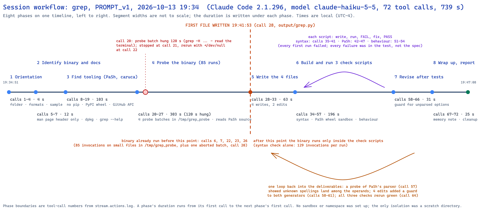
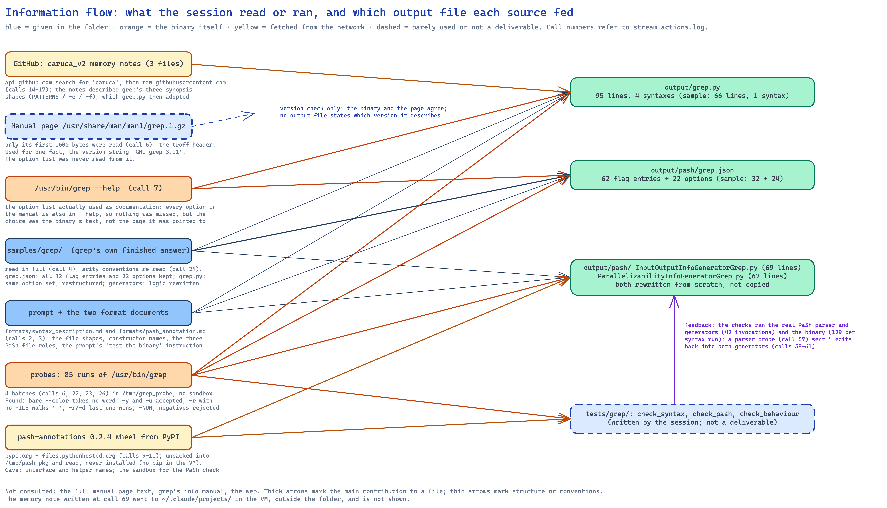

# Analysis of one run: `grep`, prompt version 1, 2026-10-13 19:34

**Run folder:** `naive_llm_caruca/runs/2026-10-13_193448_naive-run-grep_grep_PROMPT_v1/`
**Written:** 2026-10-13, from `stream.jsonl`, `stream.actions.log`, the session transcript, `run.env`,
`environment.txt` and the four output files. Call numbers below are the tool-call numbers printed in
`stream.actions.log` (1 to 72); times are local (UTC−4) as printed there.

## Summary

A fresh Claude Code session (version 2.1.296, model `claude-haiku-5-5`, permissions bypassed) in a
throwaway Ubuntu 24.04 virtual machine was given the bare prompt (version 1) for `grep`, a command
whose finished answer was sitting in the samples folder. In 739 seconds, 73 turns and 72 tool calls
it produced all four files, at a list-price cost of $0.96. It did not copy the sample: it read it,
then re-derived the description from `grep --help` and from 85 probe runs of the binary, and ended
up disagreeing with the sample in several places that the binary bears out (for example, `grep -r
PATTERN` with no file reads the current directory, not standard input). It ran the binary before
writing anything, built three test scripts of its own, ran the real PaSh parser and annotation
classes from a wheel it downloaded from PyPI, and fed one test finding back into the deliverables.
It set up no isolation beyond a scratch directory, ran nothing destructive, read only the first 1500
bytes of the manual page it was pointed to, and fetched three of this project's own memory notes
from GitHub. Its closing report is accurate except for one claim: it says the sample's parser table
lacked `-y` and `-u`, but the sample already has both. No output file states which grep version it
describes.

## 2.1 Timeline and phases

The session's 72 tool calls fall into eight phases. A phase's duration runs from its first call to
the next phase's first call.

| # | Phase | Calls | Start | Duration | What it read or ran |
|---|---|---|---|---|---|
| 1 | Orientation | 1–4 (4) | 19:34:51 | 4 s | listed the folder, ran `grep --version` (which hit a shell wrapper, see 2.8), read both format documents, read all four grep sample files |
| 2 | Identify the binary and its documentation | 5–7 (3) | 19:34:55 | 12 s | first 1500 bytes of the manual page, `dpkg`, discovered `grep` is a shell function, `/usr/bin/grep --version`, five first probes, `/usr/bin/grep --help`, checked whether `caruca` or `pash_annotations` import |
| 3 | Find tooling | 8–19 (12) | 19:35:07 | 103 s | searched the filesystem, found no `pip`, checked PyPI, downloaded and unpacked the `pash-annotations` 0.2.4 wheel and read its parser, generators and interfaces; searched GitHub for "caruca", listed this repo's tree, fetched three memory notes |
| 4 | Probe the binary | 20–27 (8) | 19:36:50 | 303 s | four probe batches in `/tmp/grep_probe` (one hung for 120 s, see 2.8), re-read the samples for arity conventions, read PaSh's `InputOutputInfo` class and helper names |
| 5 | Write the deliverables | 28–33 (6) | 19:41:53 | 63 s | wrote `grep.py` (call 28), `grep.json` (30), the input/output class (31), the parallelizability class (32); two comment edits |
| 6 | Build and run the checks | 34–57 (24) | 19:42:56 | 196 s | wrote and ran `check_syntax.py`, `check_pash.py`, `check_behaviour.py`; each first run failed, each failure was in the test, each was fixed; probed PaSh's parser on six spellings |
| 7 | Revise after testing | 58–66 (9) | 19:46:12 | 31 s | added a guard to both generator classes (calls 58–61), taught the PaSh check to expect it, reran all three checks, ran the PaSh check against the sample's classes |
| 8 | Wrap up and report | 67–72 (6) | 19:46:43 | 25 s | re-read the generators, wrote a memory note, final run of all checks, deleted `__pycache__`, reported at 19:47:08 |

**First write:** call 28 at 19:41:53, `output/grep.py`, seven minutes into the session. The binary
had already been run in calls 6, 7, 22, 23 and 26 before that point (85 invocations with inputs,
plus `--version` and `--help`), so the files were written after probing, not before. After the first
write the binary ran only inside the check scripts (the syntax check alone makes 129 invocations per
run).

## 2.2 Sources it used

**Inside the folder.**
- The two format documents, read in full (calls 2 and 3).
- The grep sample, all four files, read in full (call 4), and the other samples' arity conventions
  (call 24: `tee.py`, `rm.py`, `uniq.py`).

**The manual page it was pointed to.** Read once, call 5, and only the first 1500 bytes (the troff
header), plus a line count. The one fact it took from it was the version string "GNU grep 3.11",
which it matched against the binary. It never read the option list from the manual page. The option
list it used came from `/usr/bin/grep --help` (call 7).

**The binary.** 85 probe invocations in four batches (calls 6, 22, 23, 26), on three small text files
and one subdirectory it created under `/tmp/grep_probe`. See 2.4 for what they established.

**Outside the folder (network).** The VM has internet access and the session used it:
- `https://pypi.org/simple/caruca/` (404) and `https://pypi.org/simple/pash-annotations/` (200), call 9.
- `https://pypi.org/pypi/pash-annotations/json`, call 10, then the wheel
  `https://files.pythonhosted.org/packages/a9/e5/.../pash_annotations-0.2.4-py3-none-any.whl`,
  call 11, unpacked under `/tmp/pash_pkg` and read (calls 12, 13, 18, 19, 25, 27, 34), never installed.
- `https://api.github.com/search/repositories?q=caruca+in:name`, call 14, which returned this very
  repository (`tirandagan/caruca_v2`); then `https://api.github.com/repos/{binpash/caruca,binpash/pash,tirandagan/caruca_v2}`
  and this repo's root listing, call 15; then the full recursive tree of `tirandagan/caruca_v2` and
  of `binpash/pash`, call 16.
- `https://raw.githubusercontent.com/tirandagan/caruca_v2/main/memory/caruca_grep_grammar_single_shape.md`,
  `.../memory/pash_grep_annotation_current_vs_json.md` and
  `.../memory/caruca_v1_grep_committed_annotation_stale_spec.md`, call 17. These are this project's
  own notes about grep's grammar having three synopsis shapes and about the sample's single
  pattern positional. The session said "I'll verify that against the binary rather than trust it"
  and then adopted the three-shape structure in `grep.py`.

This is a leak in the experiment's framing, not in the package: the package withholds everything
about v1, but the public repository does not, and a GitHub search for the word "caruca" finds it. The
notes influenced the structure of `grep.py` (four syntaxes instead of the sample's one).

**Copied versus derived (grep is one of the four samples).** Diffs of `output/` against
`samples/grep/`:

| File | Sample | Output | Relation |
|---|---|---|---|
| `grep.py` | 66 lines, 1 syntax | 95 lines, 4 syntaxes | same 47-option set and the same constructor names, restructured into a shared `_options` list and four syntaxes; adds `-y` as an alias of `-i`, `-u`, `min=0` on the three context counts, a second `--color` node for the `--color=WHEN` form, and arity on the glob options. Every line differs from the sample; the option inventory does not |
| `pash/grep.json` | 32 flag entries, 24 options | 62 flag entries, 22 options | the sample's 32 flag entries and 22 of its options are kept verbatim (reformatted onto single lines); removed: the two `--color WHEN` option entries; added: 30 flag entries, namely `-0` to `-9` and the 20 `--color=WHEN` / `--colour=WHEN` spellings. So the table is the sample plus 30 entries minus 2 |
| `pash/InputOutputInfoGeneratorGrep.py` | 42 lines | 69 lines | rewritten; shares only the class name and base class. The sample's commented-out TODO about `-r` without a directory is what the output implements |
| `pash/ParallelizabilityInfoGeneratorGrep.py` | 71 lines | 67 lines | rewritten; the sample's custom mapper/aggregator placeholders are dropped in favour of a single "can split or not" decision |

So: the parser table was largely copied and extended; the syntax file reused the sample's option
inventory but was restructured; the two classes were derived, not copied.

## 2.3 Isolation and safety

- **No isolation.** No namespace, container, `unshare`, `chroot`, dry run or copy-on-write setup was
  attempted. The VM has `unshare` and `strace` installed; neither was used. The only separation was a
  scratch directory, `/tmp/grep_probe` (created in call 6), and later `/tmp/pash_pkg` for the
  downloaded wheel and a `tempfile.mkdtemp` directory inside each check script.
- **Nothing destructive.** `grep` only reads. The session's own deletions were of its own artifacts:
  `rm -rf output/__pycache__ tests/grep/__pycache__` (call 72). It did write outside the folder: the
  scratch directories above and a memory note under `~/.claude/projects/` (calls 69–70).
- **Where it worked.** The task folder `~/naive-arm` for the deliverables and a `tests/grep/`
  directory it created there; `/tmp` for probes and the wheel.
- **Untrusted code.** It said of the wheel "Its contents are untrusted, so I'll only read them and
  won't execute anything from it" (19:35:13), then at call 43 ran the wheel's parser and generator
  classes inside its PaSh check. The check copies the package into a fresh temporary directory and
  imports from there, so the statement was revised in practice without being revisited in words.
- **No system-call tracing.** Reads and writes were reasoned out from `--help` text and from
  observed output, not observed with `strace`.

## 2.4 Testing

**Probes before writing (calls 6, 22, 23, 26; 85 invocations).** Inputs: `a.txt` with three lines
(`hello`, `world`, `Hello again`), two pattern files, and `sub/b.txt` containing `hello`. What it
established, each by an actual run with its exit code recorded:
- `-y` is accepted as a synonym of `-i`; `-u` is accepted with an "obsolete" warning (call 22).
- Bare `--color` takes no following word; `--color=yes`, `=tty`, `=ALWAYS` are accepted; `--color=bogus`
  prints usage but exits 0 (calls 22, 23, 26).
- `-E -F` together is "conflicting matchers" (exit 2); `-E -E` is fine (calls 22, 23).
- Every option it tried can be repeated (15 options, call 23).
- `-r` with no file operand walks the current directory; `-r -d skip` (last wins) reads standard
  input instead (calls 23, 26).
- `-A -1`, `-C -1` and `-m abc` are rejected with exit 2; `-m -1` is accepted (calls 22, 26).
- `-d rec` and `-d recurs` are accepted as prefixes of `recurse` (call 22).
- `-0`, `-2`, `-25` work as context counts; options may follow operands (call 26).
- `-f -` reads patterns from standard input (call 26).

**Three check scripts written afterwards** (`tests/grep/`, not part of the deliverable):
1. `check_syntax.py` (calls 35–41): loads `output/grep.py` against a stub of the `caruca.ir.syntax`
   module that records constructor calls, then runs `/usr/bin/grep` once per option spelling (94
   runs, since each `Selection` choice is tried), twice for bare `--color`/`--colour`, 7 runs for
   rejected negative counts, and 26 "shape" cases with expected exit codes: 129 invocations per run.
   First run (call 39): 4 failures, all in the harness (it appended a pattern word after `-e`/`-f`).
   Fixed (call 40), passed (call 41).
2. `check_pash.py` (calls 42–50, 62–66): unpacks the downloaded wheel into a temporary directory,
   replaces its grep table and the two grep classes with `output/pash/`, and runs PaSh's real
   `parse()` and both generator classes on a list of invocations, comparing operand roles, implicit
   input, implicit output and whether two parallelizers are produced. First run (call 43): 3 failures,
   all in the harness (standard input's name is an enum). Fixed, 36 of 36 invocations matched (call
   47). After the revision in phase 7 the list grew to 42 and 42 of 42 matched (call 64).
3. `check_behaviour.py` (calls 51–56): checks which invocations read standard input or walk `.`,
   that `-q` writes nothing, and, for 21 invocations on standard input and 4 on a file, that
   splitting a 400-line random corpus into 4 consecutive chunks and concatenating grep's outputs
   gives the same bytes as one run; for 7 excluded invocations (`-c -n -b -m -A -l -L`) that the split
   changes the output. First run (call 53): 1 failure, `-L` did not diverge on that corpus because
   every chunk contained a match; it gave `-L` a dedicated input whose first chunk has no match
   (call 54) and passed.

**The closing report's claims, checked against the log.**

| Claim | Supported? |
|---|---|
| "I tested /usr/bin/grep, which is GNU grep 3.11, the same version as the man page" | Yes: call 6 (`--version`) and call 5 (`.TH GREP 1 ... "GNU grep 3.11"`) |
| "every spelling in the spec is accepted by grep with a value of the declared type, each shape runs, and invalid calls fail" | Yes for what the script covers: 86 unique spellings, 26 shape cases, 7 rejections; passed at calls 41, 56, 64, 71 |
| "ran the real parser and generator classes from the released pash-annotations 0.2.4 wheel on 42 invocations. All match." | Yes: call 64, "all 42 invocations match" |
| "The sample's generators fail 50 of these checks" | Partly. Call 66 prints "50 annotation check(s) failed", but the unit is a per-field comparison (operands, implicit input, parallel flag), not an invocation. The denominator is not 42 invocations; it is the number of fields compared across 42 invocations, and one of the 42 made the sample's class raise, which counts as one failure. "50 failed field comparisons across 42 invocations" is the supportable wording |
| "For every invocation marked splittable, splitting the input into chunks and concatenating gives the same bytes" | Yes, for the 25 invocations in the script, on one 400-line corpus, 4 chunks (calls 54, 56) |
| "For the excluded ones, splitting changes the output" | Yes, for the 7 listed, after the `-L` input was changed so that it would (call 54). The claim holds on chosen inputs, which is the right test for an exclusion, but it is not a general proof |
| "`grep -r PAT` with no file was annotated as reading stdin" (sample defect) | Yes: call 48 output shows the sample giving `STREAM_INPUT:stdin` for `grep -R hello`, `grep -d recurse hello` and others |
| "Long spellings like `--after-context` were not seen, so those were marked splittable" (sample defect) | Yes: call 66 output shows `--after-context 1` and `--context 1` as `parallel: got True` with the sample |
| "`--color` took its value as a separate word, but grep only accepts `--color=WHEN`" (sample defect) | Yes: the sample table lists `--color WHEN` as an option; call 22 shows bare `--color hello a.txt` treats `hello` as the pattern. The session did not try `--color always hello a.txt` directly, but `--help` says `--color[=WHEN]` and the bare run is consistent |
| "`-y`, `-u`, `-NUM` and the `=` forms of `--color` were missing from the table" (sample defect) | **No, for `-y` and `-u`.** The sample's `grep.json` already lists `["-i","-y","--ignore-case"]` and `["-u","--unix-byte-offsets"]`. Only `-0`…`-9` and the `--color=WHEN` spellings were missing. The same wrong statement appears earlier, at 19:41:57 ("adds the undocumented `-u`/`-y` spellings"), so it is a misreading of the sample that the session carried through, not a slip in the report |
| "Nothing was committed" | Yes: no git command in the log |
| "I also saved one memory note" | Yes: calls 69–70, under `~/.claude/projects/-home-tirandagan-guest-naive-arm/memory/` in the VM |

## 2.5 Reproducibility and versions

- **Recorded during the run:** the binary's version (`grep (GNU grep) 3.11`, call 6), the package
  (`dpkg` in call 5), Python 3.12.3 (call 7), the manual page's own version stamp (call 5). The OS
  was never queried (`run.env` records it: Ubuntu 24.04.4 LTS, aarch64), and the session's report
  names grep 3.11 but not the OS.
- **In the output:** none of the four files states which grep version or which system it describes.
  `grep.py` has comments explaining decisions ("accepted but undocumented", "-NUM is not expressible
  here") but no version line; `grep.json` is bare data; the two classes have comments but no version.
- **Repeatability of probes:** every probe was run once. The behaviour check uses a fixed random
  seed (7) so its corpus is reproducible, and the memory note it saved (call 69) is the only place
  it reflected on environment dependence (the `grep` shell function, see 2.8).
- **Prompt version 1 asks for none of this**, so the absence is a baseline reading, not a failure
  against the instructions.

## 2.6 Deliverable quality, mechanically

- `output/grep.py` parses (`ast.parse`), and it also **imports under v1's real
  `caruca.ir.syntax` module** (checked on this Mac with v1's virtual environment): four syntaxes,
  with 2, 47, 49 and 49 option nodes and 0, 2, 1 and 1 positionals. The `min=0` keyword on
  `Integer` and `arity=` on `Glob` and `Path` options, which the session inferred from the format
  document and the samples, are accepted by v1's constructors.
- Both PaSh classes parse (`ast.parse`); `grep.json` is valid JSON with 62 flag entries and 22
  option entries. The session ran both classes under PaSh's own parser in the VM (2.4); running them
  in the pash VM is a separate step and was not done here.
- **Parser table versus the manual** (GNU grep 3.11 man page, the same version as in the VM, using
  the copy v1 keeps at `caruca/src/caruca/doc_sources/man/grep.txt`):
  - Omissions: none. Every option in the manual's OPTIONS section is in the table, with every
    long spelling.
  - Inventions beyond the manual: `-y` and `-u`/`--unix-byte-offsets` (not in the 3.11 manual or
    `--help`, but accepted by the binary, verified at call 22; the sample had them too); the ten
    single-digit flags `-0`…`-9`, which approximate the manual's `-NUM` (the table cannot express
    `-25`, so `grep -25 x` would still misparse); and the 20 `--color=WHEN` tokens for nine values
    (`always yes force never no none auto tty if-tty`) where the manual lists three (`never always
    auto`). The six extra values are GNU grep's documented-in-source synonyms and the binary accepted
    `yes`, `tty` and `ALWAYS` in probes; all nine `=` forms were accepted in the syntax check (call 41).
  - Structural choice to note: the `-e`/`--regexp` and `-m`/`--max-count` option pairs are listed as
    separate entries rather than one entry with two spellings, following the sample.
- **Syntax file versus the manual:** no omissions; the same `-y` and `-u` additions; `-NUM` is
  declared inexpressible in a comment.
- **Known limits the session itself listed** and that the log confirms: PaSh's parser reads only
  exact tokens, so `--max-count=1`, `--include=*.c`, `--regexp=x`, `-A1` and `--` are left among
  the operands (call 57 output); the generators now raise on any leftover operand that starts with
  `-`, which PaSh treats as "no annotation". That is safe but loses those invocations.

## 2.7 Cost and effort

From the `result` event in `stream.jsonl`:

| Measure | Value |
|---|---|
| Model | `claude-haiku-5-5` (list-price cost basis, billed to the Max subscription) |
| Turns | 73 |
| Tool calls | 72: Bash 43, Write 9, Edit 15, Read 4, TaskStop 1 |
| Wall clock | 739 s (API time 612 s); 19:34:48 to 19:47:08 |
| Input tokens (uncached) | 140 |
| Cache writes | 225,211 tokens |
| Cache reads | 11,219,195 tokens |
| Output tokens | 123,918, of which 82,852 thinking |
| Reported cost | $0.96 at list price |
| Permission denials | 0 (permissions bypassed) |
| Web search / fetch tools | 0 (all network access went through `curl` in Bash) |

Of the 43 Bash calls, 9 reached the network, 7 ran the binary directly (one of them through the
shell wrapper, see 2.8), and 12 ran the check scripts or PaSh's parser through them. Of the 9 writes, 4 are deliverables, 3 are check scripts, 2 are the memory note and
its index.

## 2.8 Behaviour worth recording

- **Claude Code's own environment shadowed the command under test.** The very first `grep --version`
  (call 1) reported "ugrep 7.8.4": Claude Code 2.1.296 defines a bash function named `grep` in the
  tool's shell that runs its bundled `ugrep` for most argument shapes (the function text is in the
  result of call 6). The session noticed within two calls, reasoned "the man page and the binary may
  disagree", printed the function, and from then on called `/usr/bin/grep` by path. For an
  experiment whose test command is `grep`, this is a confound built into the harness: a less careful
  session would have described ugrep. It also means `run.env`'s "binary=/usr/bin/grep" is the right
  thing to have recorded.
- **It found this project on GitHub and read our notes** (calls 14–17; see 2.2). The search was for
  the `caruca` package in order to learn the DSL's constructor semantics; it did not find the private
  v1 repository (`binpash/caruca` returned "Not Found", call 15) but did find and use `caruca_v2`.
- **A probe batch hung for two minutes** (call 20): one case, `grep --label foo -H hello -`, read
  the terminal because no input was redirected. The tool moved the batch to the background after
  120 s; the session stopped it (call 21) and reran the whole batch with `</dev/null` and `timeout 5`
  (call 22). It recorded the lesson in its memory note.
- **Dead end:** 103 seconds looking for installable packages: `pip` is absent from the stock image,
  `caruca` is not on PyPI, and `pash-annotations` was downloaded and read rather than installed.
- **It wrote tests the prompt did not ask for** (three scripts, 24 calls, about 40 percent of the
  tool calls), and it deliberately checked that its PaSh harness could fail by pointing it at the
  sample's classes (calls 48, 66).
- **It revised the deliverables once after testing**, on evidence from PaSh's real parser (call
  57), adding the unrecognised-option guard to both classes (calls 58–61).
- **It wrote a memory note outside the task folder** (calls 68–70), in Claude Code's per-project
  memory directory in the VM, about the `grep` shell function. Nothing in the prompt invited this; it
  is Claude Code's default memory behaviour. A clone is deleted after collection, so the note does
  not persist, but it shows the session treating the VM as a place it would return to.
- **No questions were asked.** The session ran unattended from the first call to the report; its
  uncertainties are listed in the report under "Decisions you may want to change" and "Limits I
  could not close".
- **It commented on three "file changed on disk" notices** from the harness (calls 44, 49, 55),
  each time re-reading the file before editing. The changes were its own `sed`/Python patches.
- **Six invocations in the final PaSh check are expected to raise** (`--max-count=1`,
  `--include=*.c`, `--regexp=hello`, `-A1`, `--label=x`, `-e hello --`), so "42 of 42 match" includes
  six cases whose expected result is "no annotation".

## What this run suggests we ask next

1. **Run a command that is not a sample.** With the answer in front of it, this run measured how much
   a session trusts a given answer (it did not, in the places it tested). A non-sample command
   measures what it does without one.
2. **Decide what to do about the GitHub leak.** The public `caruca_v2` repository is one search away
   and contains our notes on every core command. Either block network access in the clone, or treat
   "did it find and use the repository" as a recorded variable per run.
3. **Decide what to do about the `grep` shell function.** Claude Code's bundled `ugrep` wrapper is
   in every session's shell. Record for each run whether the session noticed, or put `command grep`
   / the binary path in the prompt (that is a prompt change, so it goes through task 016's log).
4. **Ask for the version in the output.** Prompt version 2 asks the session to state the OS and
   command version in its report; this run shows the files themselves carry no version, so the
   question for version 2 is whether the session puts it in the files, not only in the report.
5. **Score the output.** `output/grep.py` imports under v1's DSL, so `caruca-v2 score` can compare it
   with v1's spec and the ground truth; the two PaSh classes can be loaded in the pash VM. Neither was
   done here.
6. **Model.** The golden image's default model is `claude-haiku-5-5`. If later runs use a different
   model, the README should say which, since this run's cost and behaviour are Haiku's.
7. **Count failed comparisons by field, not by invocation,** when quoting the session's "50 failed
   checks" figure for the sample.

## Diagram tooling

The two diagrams were drawn with the Excalidraw diagram skill from
`https://github.com/coleam00/excalidraw-diagram-skill`, installed into `.claude/skills/excalidraw-diagram/`.
**The skill's repository declares no licence**; it is listed as third-party, unlicensed material in
`LICENSE-TEMPLATES.md`, and Tiran's decision (2026-10-13) was to keep it in the repository on that
basis. One local change was needed to render
on 2026-10-13: the skill's `render_template.html` imports `@excalidraw/excalidraw` from `esm.sh`
without a version, and that build failed in the headless browser because a dependency file
(`@braintree/sanitize-url@6.0.2/es2022/dist/constants.mjs`) returned 404 on the CDN; pinning the
import to `@excalidraw/excalidraw@0.18.0?bundle` fixed it. The original template is kept beside it as
`render_template.html.orig`. Each diagram was rendered with
`uv run python render_excalidraw.py <file>`, inspected, and corrected twice before it passed.
