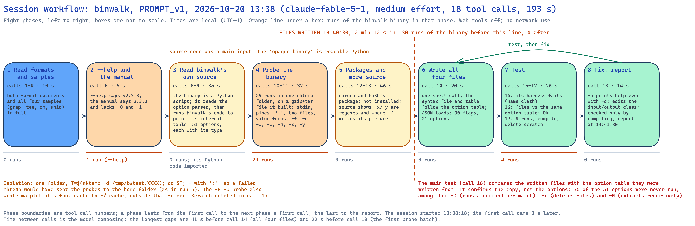
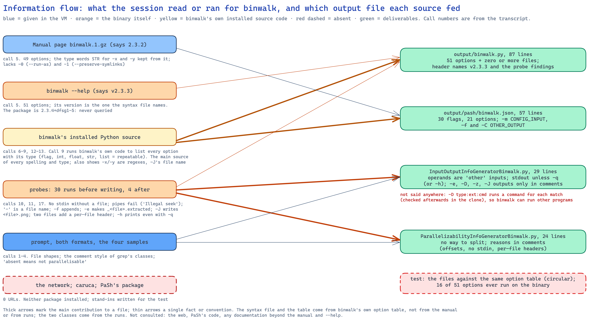
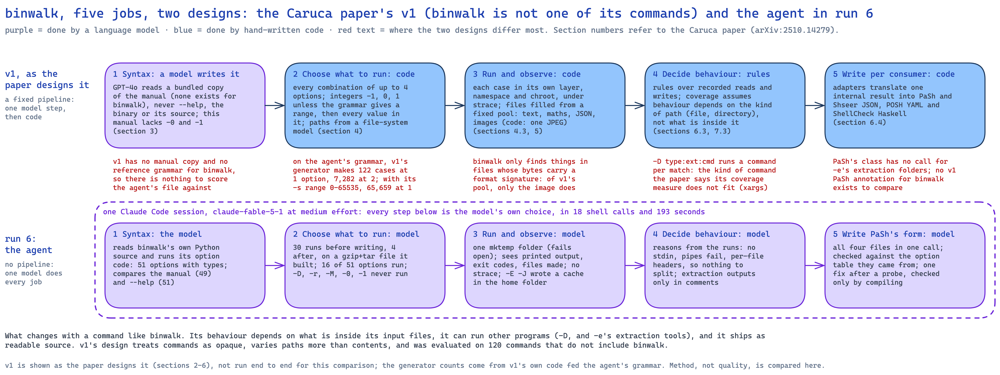

# Analysis of one run: `binwalk`, prompt version 1, 2026-10-20 13:38 (run 6)

**Run folder:** `naive_llm_caruca/runs/2026-10-20_133813_naive-run-binwalk_binwalk_PROMPT_v1/`
**Written:** 2026-10-20, from `stream.jsonl`, the session transcript, `run.env`, `environment.txt`, the four
output files, and checks run afterwards in the same virtual machine (the clone was kept for this). Call
numbers are the session's tool calls in order (1 to 18); times are local (UTC−4). This is the first run on a
command that is not one of the Unix core utilities, and the first whose command has no sample and no v1
reference. It used the same setup as runs 4 (`grep`) and 5 (`rm`), so the command is the only change.

## Summary

A fresh Claude Code session (version 2.1.296, model `claude-fable-5-1` at medium effort, permissions
bypassed, web tools and MCP servers removed) in a throwaway Ubuntu 24.04 virtual machine was given prompt
version 1 for `binwalk`, a tool that scans binary files (firmware images, archives) for embedded files and
can extract them. binwalk was installed from Ubuntu's package (`binwalk 2.3.4+dfsg1-5`). In 193 seconds,
19 turns and 18 tool calls the session produced all four files, at a list-price cost of $2.12, with no
network use. The run's defining feature: **`/usr/bin/binwalk` is a four-line Python script**, and the
session went straight to binwalk's installed Python source. In call 9 it ran binwalk's own code to print
the program's internal table of options with their types, and wrote the syntax file and the PaSh table from
that table, not from the manual. It then ran the binary 30 times in a scratch folder on a gzip-plus-tar file
it built, wrote all four files in one call, and tested them mainly by comparing them with the same internal
table they were written from. It ran 16 of the 51 options on the binary at least once. Its findings from
the runs are sound: binwalk never reads standard input on its own, cannot read a pipe, appends to its log,
and prints a per-file header when given several files, so nothing can be split. Two things are missing from
its files: `-D type:ext:cmd` runs a command for every match (checked afterwards), and the extraction folders
`-e` creates cannot be named in PaSh's input/output class, so they appear only in comments. Against v1's
design the contrast is sharper than for `grep` or `rm`: binwalk's behaviour depends on what is *inside* its
input files, which v1's design varies only a little, and the command ships its own source code, which v1's
design never reads.

## What this run teaches

In plain terms, the most useful things run 6 shows. One run, so these are observations to test, not
conclusions.

- **"Opaque" depends on how the command is packaged.** Caruca's premise is a command you can run but not
  read. binwalk, like many tools installed from a package manager, ships as readable Python. Given a
  machine with the source on it, the agent read the source first and trusted it most. The prompt's ban on
  "code repositories" does not cover code already installed on the machine.
- **Reading the source got the option list right, and it found a gap in the manual.** The manual is for an
  older version (2.3.2) and lacks two options (`-0`, `-1`) that the installed program has. The agent
  spotted this by comparing the manual, `--help` and the source. v1's model reads only the manual.
- **But it checked its answer against itself.** The main test compares the written files with the same
  internal table they were copied from. That proves the copy, not the command: 35 of the 51 options were
  never run, including the two that do the most (`-D`, which runs commands, and `-r`, which deletes files).
- **It missed that binwalk can run other programs.** `-D type:ext:cmd` runs `cmd` on every match. That
  makes binwalk a command like `xargs`, the kind the Caruca paper singles out as hard. None of the four
  files says so.
- **A sensible description can be a trap for v1's machinery.** The agent wrote the status-server port as
  a number from 0 to 65,535. That is correct, but v1's generator tries every value in a range, so this one
  line alone would make v1 run binwalk 65,536 times. Without it, v1 would make 122 cases.
- **binwalk shows where v1's test inputs run out.** binwalk finds things only in files whose bytes carry a
  format signature. Of the eight files v1 fills its test folders with, it finds something in one (a JPEG
  image, and only the image's own header). In v1's default setting, which uses text only, every v1 run of
  binwalk would print an empty table.

**What it means.** On a command outside the core utilities, the agent adapted: it found the better source of
truth on the machine and used it. Its weakness is the same as in runs 4 and 5: it checks less than it
reports, and the behaviour that matters most (what the command writes, deletes or runs) is the part it
probed least.

## 2.1 Timeline and phases

The session started at 13:38:18 and made its first call 3 seconds later. A phase lasts from its first call
to the next phase's first call; the last runs to the closing report at 13:41:30.

| # | Phase | Calls | Start | Duration | What it read or ran |
|---|---|---|---|---|---|
| 1 | Read formats and samples | 1–4 (4) | 13:38:21 | 10 s | listed the folder; both format documents; all four samples in full (`grep`, `tee`, `rm`, `uniq`); call 2's output was too long and was saved to a file, so call 3 and 4 re-read it in parts |
| 2 | `--help` and the manual | 5 (1) | 13:38:31 | 6 s | `file /usr/bin/binwalk` (a Python script), its first lines, `binwalk --help` (says v2.3.3), the manual rendered in full (says 2.3.2) |
| 3 | Read binwalk's own source | 6–9 (4) | 13:38:37 | 35 s | located the package at `/usr/lib/python3/dist-packages/binwalk`; read the argument-parsing code (`core/module.py`, `modules/general.py`); in call 9 imported binwalk's module registry and printed every option with its short and long spelling, type, hidden status and defaults |
| 4 | Probe the binary | 10–11 (2) | 13:39:12 | 32 s | 29 runs in `/tmp/bwtest.ydzo` (see 2.3) on a file built from gzip and tar output: standard input, `-`, `/dev/stdin`, a pipe, a named pipe, two files against two runs, value forms of `-l`, bundled `-Bq`, repeated `-y`, `-x`, `-f`, `-c`, `-e` with and without `-C`, `-m /dev/null`, `--string`, `-h`, `-E -J`, `-W`, `--len`, hex `-o` |
| 5 | Packages and more source | 12–13 (2) | 13:39:44 | 46 s | tried to import `caruca` and `pash_annotations` (neither installed), `pip list`; grepped the source for how `-x`/`-y` are used (compiled as regular expressions) and where `-J` writes its picture. 41 s of this phase is the model composing call 14 |
| 6 | Write all four files | 14 (1) | 13:40:30 | 20 s | one shell call with four here-documents; the JSON loads (30 flags, 21 options) |
| 7 | Test | 15–17 (3) | 13:40:50 | 26 s | call 15: a harness with stand-in `caruca` modules fails because the syntax file `binwalk.py` hides the real `binwalk` package; call 16: the harness again, loading the file by path: syntax file and table both match binwalk's internal table ("OK"); call 17: four more runs (last value wins for `-l`, `-q` silences the report, `-s 0` accepted, `-h -q` still prints 4,247 bytes), then compiled the Python and deleted the scratch folders |
| 8 | Fix and report | 18 (1) | 13:41:16 | 14 s | edited the input/output class so `-h` counts as using standard output even with `-q`; compiled it; report at 13:41:30 |

**First write:** call 14 at 13:40:30, all four files at once, 2 min 12 s into the session. Before it the
binary ran 30 times (`--help` in call 5, 9 runs in call 10, 20 in call 11). After it, 4 more runs (call 17).
The only write-test-fix loop is call 17 → call 18; the fix was then checked only by compiling.

## 2.2 Sources it used

**Inside the folder.** Both format documents and all four samples, in full (calls 1 to 4). There is no
`binwalk` sample, so unlike runs 4 and 5 nothing could be copied. The samples shaped the files' form: the
input/output class follows `grep`'s comment layout (`list_of_all_flags`, `list_of_all_options`, "Which ones
do affect input/output?").

**The manual page it was pointed to.** Read in full in call 5. It describes binwalk 2.3.2 (its footer and its
header, generated by `help2man` in September 2021) and lists 49 options. The session used it for the type
words in the table (`STR` for `-x` and `-y`, kept "matching the manual's wording") and noticed that it
lacks `-0`/`--run-as` and `-1`/`--preserve-symlinks`.

**`--help`.** Lists 51 options and says v2.3.3. The syntax file's header names v2.3.3.

**binwalk's installed source code: the main source.** Calls 6 to 9, 12 and 13 read the Python package
behind `/usr/bin/binwalk`. Call 9 went further than reading: it imported binwalk's `Modules` registry and
printed each module's `CLI` option list. That table gives every spelling, whether the option takes a value,
and the value's Python type (`int`, `float`, `str`, `list` for repeatable). The syntax file and the parser
table follow it one for one, and the session says so ("Options were derived from binwalk's own module table
rather than the man page"). Calls 12 and 13 used the source for two more facts: `-x`/`-y` are compiled as
regular expressions (so typed `Regex` in the syntax file), and `-J` writes `<file>.png` in the current
folder.

**The binary.** 34 runs (2.4).

**Outside the folder.** No network use: `bash_urls=0`. The session looked for the `caruca` and
`pash_annotations` packages on the machine only (call 12) and, finding neither, wrote stand-ins.

**Versions it did not reconcile.** Three version numbers describe this one program: the package
(`2.3.4+dfsg1-5`, from `dpkg`), the program's own report (`v2.3.3`), and the manual (`2.3.2`). The session
saw the last two and never queried the package.

## 2.3 Isolation and safety

- **One scratch folder.** Call 10 opens with `set -x; T=$(mktemp -d /tmp/bwtest.XXXX); cd $T; …`. All probes
  in calls 10, 11 and 17 ran in `/tmp/bwtest.ydzo` on files the session created there. No namespace,
  container or copy-on-write layer; `strace` (installed) was not used.
- **The guard fails open, as in run 5.** The commands are joined by `;`, not `&&`, and there is no `set -e`:
  had `mktemp` failed, `cd` with no argument would have gone to the home folder and the probes, including
  two extraction runs, would have written there.
- **One write escaped the folder.** The `-E -J` probe (entropy plot saved as a picture) loads the plotting
  library matplotlib, which wrote its font cache to `~/.cache/matplotlib/fontlist-v330.json` at 13:39:31
  (timestamp checked in the clone). Harmless, but it is a write outside the scratch folder that the session
  neither intended nor noticed.
- **Extraction ran external programs.** `-e` makes binwalk call extraction tools (here `gzip` and `tar`) on
  the carved data; this happened twice, inside the scratch folder.
- **The riskiest options were not run.** `-D` (runs a command per match), `-r` (deletes carved files), `-M`
  (recursive extraction), `-0` (run extraction tools as another user) and `-1` (keep symbolic links that
  point outside the extraction folder, which binwalk's own help calls "dangerous") were never run.
- **Clean-up.** Call 17 deleted the scratch folder and the stand-in module folder; nothing was left in the
  work folder but the four files.
- **Not the session's doing:** `~/.config/binwalk/` (empty configuration files) exists in the clone with a
  timestamp of 13:37:38, before the session started. It was created in the golden image by the analyst's
  pre-run check (`binwalk --help`), so it is now in the golden image and in every clone made from it.

## 2.4 Testing

**The 34 runs of the binary, and what they established.**
- With no file, binwalk prints its help and exits 1. `binwalk -` treats `-` as a file name (exit 3).
  `binwalk /dev/stdin < file` works (the redirected file is seekable); `cat file | binwalk /dev/stdin` and
  a named pipe both fail with "Illegal seek".
- Two files in one run print a "Scan Time / Target File / MD5 Checksum / Signatures" header per file, which
  two single-file runs do not.
- `-l 70`, `-l70`, `--length=70`, `--length 70` and `--len 70` are all accepted (each found the tar header at
  byte 62, as a run without `-l` would; the probe shows acceptance, not the limit's effect). With
  `-l 10 -l 70` the last value wins. `-o 0x3E` skips the gzip header at byte 0, so hexadecimal values work.
- `-Bq` prints nothing; `-q -B` prints 0 bytes; `-h -q` still prints the help (4,247 bytes).
- `-y gzip -y tar` keeps both matches where `-y gzip` keeps one, so `-y` is repeatable; `-x gzip` drops the
  gzip match.
- `-f log` appends on a second run; `-c` writes CSV to the log.
- `-e` creates `_combo.bin.extracted/` in the current folder, or under the folder given with `-C`.
- `-E -J` writes `combo.bin.png` in the current folder. `-W` shows a hex comparison of two files.
- The hidden `--string` option crashes with a Python traceback (`can't concat str to bytes`) but exits 0.

**The test after writing (calls 15 to 17).** Call 16's harness compares every option in the syntax file and
the table with binwalk's internal table: spelling, long alias, flag versus value, `int` → `Integer`, and
repeatable → `ZERO_OR_MORE`. It printed "OK" for both files. Because both files were written from that same
table, this confirms the transcription, not the command's behaviour. Call 17 added four runs of the binary.

**Options run on the binary:** 16 of the 51 in the files (`-B -C -E -J -W -c -e -f -h -l -m -o -q -s -x
-y`). Never run: `-0 -1 -A -D -F -G -H -I -K -L -M -N -O -P -Q -R -S -U -V -X -Z -a -b -d -g -i -j -n -p -r
-t -u -v -w -z` (35).

**The closing report's claims, checked against the log.**

| Claim | Supported? |
|---|---|
| "verified against the installed binwalk v2.3.3" | Partly: the option list was checked against binwalk's own table, and 16 options were run. "v2.3.3" is the program's self-report; the package is 2.3.4+dfsg1-5 |
| "the man page is for 2.3.2 and omits `-0/--run-as` and `-1/--preserve-symlinks`, which the binary accepts" | The manual part, yes (call 5). "Which the binary accepts" came from `--help` and the source; neither option was run. Both are accepted (checked afterwards in the clone) |
| "Spellings, flag-versus-value, integer typing, and repeatability all matched" | Yes, against the internal table (call 16); float and string types were not compared |
| "`-l 70`, `-l70`, `--length 70`, `--length=70` and the abbreviation `--len` all work; `-Bq` bundling works" | Yes: accepted (call 11) |
| "`-D`, `-R`, `-m`, `-x`, `-y` accumulate when repeated while other options keep the last value" | **Partly:** only `-y` was run repeated, and only `-l` for last-wins. The rest comes from the source's `list` type. Checked afterwards: `-x gzip -x tar` drops both matches, so `-x` does accumulate |
| "integers accept hex" | Yes: `-o 0x3E` (call 11) |
| "Stdin is never read" | **Too strong:** its own call 10 showed `binwalk /dev/stdin < file` works. binwalk never reads standard input *by default*, and cannot read it from a pipe |
| "No operand prints the help and exits 1; `-` is a literal file name; a pipe or FIFO fails" | Yes (call 10) |
| "`-f` appends … `-e` writes `_<file>.extracted` under the current directory or `-C DIR`; `-J` writes `<file>.png`" | Yes (call 11) |
| "Running two files in one invocation is not the concatenation of two single-file runs" | Yes (call 10) |
| "`-x`, `-y`, `-a`, `-p` are compiled as Python regexes in the source" | For `-x`/`-y`, yes (call 13). For `-a`/`-p` the log shows only `--help`'s wording ("match this regex"), not the source |
| "The hidden API-only `--string` flag … crashes when used from the shell" | Yes, with a traceback, though the exit status was 0 (call 11) |
| "Neither `caruca` nor `pash_annotations` is installed here" | Yes (call 12) |

## 2.5 Reproducibility and versions

- **Recorded during the run:** `--help`'s "v2.3.3" and the manual's "2.3.2". Not recorded: the package
  version, Python's version (3.12.3), the OS (in `run.env`: Ubuntu 24.04.4 LTS, aarch64).
- **In the output:** the syntax file's header names v2.3.3 and says the manual is for 2.3.2; the
  input/output class says "checked against binwalk v2.3.3". The table and the parallelizability class name no
  version (2 of 4 files; run 4 had 3 of 4, run 5 had 1 of 4).
- **Repeatability:** each probe ran once. Dates and times in binwalk's output (the gzip header's
  modification time, "Scan Time") change between runs, so its output is not byte-for-byte repeatable.

## 2.6 Deliverable quality, mechanically

- All four files parse (`ast.parse`, `json.load`).
- `output/binwalk.py` **imports under v1's real `caruca.ir.syntax`** (v1's virtual environment on the Mac): 1
  syntax, 51 option nodes (30 `Flag`, 9 `Integer`, 9 string-like, 3 `Path`), 1 operand (`Path`, zero or
  more).
- **Against the manual and `--help`:** the manual lists 49 options, `--help` 51 (the two extra are `-0` and
  `-1`). The syntax file and the table each hold the 51 and nothing else. The hidden `--string` is left out
  deliberately.
- **Types the format cannot express.** `-H` and `-L` take decimal numbers; the format has no such type, so
  they are `Other` (the session flagged this). The format also has no way to say that `-l70`, `--length=70`
  and `--len` are all accepted; the file states one form per option and lists the rest in a comment.
- **A range that v1 would enumerate.** `Integer(flag="-s", min=0, max=65535)` is a correct description of a
  port number. v1's `Integer` produces every value from `min` to `max` (`ir/syntax.py`, lines 263 to 269; the
  default range is −1 to 1). Fed to v1's own generator, this one line produces 65,536 invocations, each of
  which would start binwalk's status server on a different port. None of v1's own reference grammars uses
  `min` or `max`; our format document mentions them without this warning.
- **The parser table.** Options that take a file are typed: `-m` as `["FILE", "CONFIG_INPUT"]`, `-f` as
  `["FILE", "OTHER_OUTPUT"]`, `-C` as `["DIR", "OTHER_OUTPUT"]`. Others carry the manual's words or the
  session's (`TYPE`, `INT`, `FLOAT`, `USER`, `PORT`, `REGEX`).
- **The input/output class, and why it names so few options.** Its code mentions only `-q` and `-h`, while its
  comments discuss `-f`, `-m`, `-e`, `-D`, `-z`, `-J` and `-C`. There are two different reasons:
  - `-f`, `-m` and `-C` are handled by the table, not the class. In PaSh 0.2.4 the class's constructor reads
    the table and types every option argument before `generate_info` runs; the interface's own comment says
    "here, we only need to specify information about operands and implicitly used resources; information
    about option arguments are provided by parsing infrastructure"
    (`InputOutputInfoGenerator_Interface.py`, lines 20 to 21, and `get_dict_option_to_class_for_arg`). So
    `-f FILE` is already an output and `-m FILE` already a configuration input; repeating them in the class
    would add nothing. `grep`'s sample does the same with `-f`.
  - `-e`, `-D`, `-z` and `-J` are flags whose outputs are files named after the input (`_<file>.extracted/`,
    `<file>.png`) and written to the current folder. None of the class's calls can declare an output that is
    neither an operand nor an option argument; the calls for standard input and output are the only
    "implicit" ones. The session wrote these outputs into comments only. **To PaSh, `binwalk -e fw.bin`
    reads `fw.bin` and writes standard output, nothing else.** This does not change what PaSh does with
    binwalk today (the parallelizability class offers no way to split), but it is an under-statement of
    what the command writes.
- **What the files do not say.** `-D type:ext:cmd` runs `cmd` for each match: checked afterwards in the clone,
  `binwalk -q -D "gzip:gz:touch RAN_%e" c.bin` created `_c.bin.extracted/RAN_p.txt.gz`. `-e` likewise runs
  external extraction programs. Neither the syntax file (where `-D` is a `String`) nor the classes say that
  binwalk can run other programs.
- **The parallelizability class** appends nothing, with reasons in comments (offsets are counted from the
  start of the file, standard input is not read, two files add per-file headers, `-W` compares files with
  each other). The runs support each reason.
- Not done here: loading the classes in PaSh's real code (pash VM).

## 2.7 Cost and effort

| Measure | Value |
|---|---|
| Model | `claude-fable-5-1`, medium effort (list-price cost basis, billed to the Max subscription) |
| Turns | 19 |
| Tool calls | 18, all Bash |
| Wall clock | 192.7 s (API time 189.3 s); 13:38:18 to 13:41:31 |
| Input tokens (uncached) | 578 |
| Cache writes | 55,655 tokens |
| Cache reads | 860,780 tokens |
| Output tokens | 15,769, of which 3,120 thinking |
| Reported cost | $2.12 at list price |
| Permission denials | 0 (permissions bypassed) |
| Web search / fetch tools | not available; 0 URLs in shell commands |

Not included: the launcher's ~$0.02 trial call that chose the model. Call 14, the four files, is the
longest call by far (9,473 characters).

## 2.8 Behaviour worth recording

- **It treated the source as the authority.** Within six calls of starting it had found that the binary is
  Python, located the package, and was reading the option parser. Every spelling and type in the syntax
  file comes from binwalk's own code. The manual became a secondary check.
- **It ran the program's code, not only the program.** Call 9 imported binwalk's module registry to print its
  internal option table: a way of asking the program what it accepts that is available only because it is
  Python. The test in call 16 repeated that import.
- **It built a realistic input.** Rather than a text file, it made a file with a gzip stream followed by a tar
  archive, so that binwalk would have something to find. This is the step v1's design has no counterpart for.
- **Its test hit a name clash it had caused.** Naming the deliverable `binwalk.py` (as the format requires)
  made Python import it instead of the real `binwalk` package; the session understood this at once and
  loaded the file by path (calls 15 and 16).
- **It acted on a probe.** Call 17 found `-h -q` still prints; call 18 changed the class. The only
  write-test-fix loop of the run, and a correct fix.
- **No questions asked**; nothing left in the work folder but the four files.

## How the Caruca paper designs the experiment, and what the agent chose instead

binwalk is not among the 120 commands of the paper's evaluation, and v1 has no manual copy, reference
grammar or committed annotation for it. So v1 cannot be scored here; the comparison is of method, using the
paper (Lamprou et al., arXiv:2510.14279, sections 2 to 7) and v1's code run on the agent's grammar.

| Job | v1, as the paper designs it | Run 6's agent |
|---|---|---|
| 1. Learn the argument syntax | GPT-4o, given a bundled copy of the manual or `--help` and worked examples, writes the syntax; imported and checked, up to three tries (section 3.2). v1's model reads only the bundled manual; for binwalk none is bundled, and the installed manual lacks `-0` and `-1` | Reads binwalk's installed source, runs its option code, and compares the manual (49 options) with `--help` (51). Result: 51 options with types |
| 2. Choose what to run | Code enumerates combinations of up to four options with typed values: integers −1, 0, 1, every choice of a selection, paths from a file-system model (section 4.2). Run on the agent's grammar, v1's own generator makes **122** invocations at one option (72 distinct) and **7,282** at two (2,535 distinct), leaving out `-s`; with `-s` as written (0 to 65,535), **65,659** at one option | 30 runs chosen by hand before writing and 4 after, on a gzip-plus-tar file it built; 16 of 51 options run |
| 3. Run and observe | Each configuration in its own OverlayFS layer, fresh namespace, `chroot`, under `strace` (section 5). Files are filled from a fixed pool (section 4.3): the paper names text, maths, JSON and "a set of PNG images ranging from 2kb to 4MB"; v1's code ships eight files, of which the one image is a JPEG (`data/usenix.jpg`), and at the default content setting uses the text only | One `mktemp` folder; sees printed output, exit codes and the files `-e` and `-J` create; no tracing |
| 4. Decide the behaviour | Rules over the recorded reads and writes (section 6.3). The coverage measure assumes "a command behavior depends not on a specific path name, but rather the identified location type (e.g., file, directory, empty)" and notes that string normalization is "not a valid normalization for commands whose semantics depend heavily on the input argument content (e.g., higher order commands like `xargs` and `nohup`)" (section 7.3) | Reasoned from the runs: operands are non-streaming inputs, standard output unless `-q`, nothing can be split |
| 5. Write for consumers | Adapters to PaSh and Shseer JSON, POSH YAML, ShellCheck Haskell (section 6.4) | PaSh's current Python form: the table and two classes |

**binwalk's behaviour lives in its input's contents.** For `grep` the contents matter only in whether a line
matches; for `rm` they do not matter at all. binwalk reports nothing unless a file contains a known format
signature. Run on v1's eight content files in the clone, binwalk found nothing in the seven text, maths,
time and JSON files and one result in the JPEG (its own header, at offset 0). At v1's default content
setting (`simple`, text only) every one of v1's binwalk runs would print an empty table, and extraction,
entropy and comparison would have nothing to work on. The agent's first move in probing was to build a
file worth scanning. This is where the paper's path-type assumption meets a command it does not fit.

**binwalk can run other programs.** `-D type:ext:cmd` runs `cmd` for every match, and `-e` runs external
extractors. The paper names commands that run other commands (`xargs`, `nohup`) as cases its string
normalization does not cover. The agent did not run `-D` and did not mention this in any file.

**The source changes the experiment.** v1's design never looks at a command's code, and the paper's subject
is "opaque" components. Many commands installed from a package manager are scripts (Python, Perl, shell)
that carry their source. Whether reading it is allowed is a choice the prompt does not make: prompt version
1 forbids online code repositories but says nothing about code already on the machine. The agent's result is
better for it on syntax and worse for it on testing, because a test against the source's own table cannot
fail.

**A grammar written for one consumer can mislead another.** The agent's `-s` range is a correct description
and a poor input to v1's generator. If agent-written grammars are ever fed to v1's pipeline, typed ranges
need a bound on how many values are tried.

**Cost.** The paper reports per-command CPU time (section 7.4) and not the cost of its model step. Run 6
took 193 seconds and $2.12 at list price.

## Run 6 compared with runs 4 and 5

Same model, effort, prompt and image; a different command each time.

| Measure | Run 4 (`grep`) | Run 5 (`rm`) | Run 6 (`binwalk`) |
|---|---|---|---|
| A finished answer in the samples | yes | yes | no |
| Wall clock · turns · tool calls | 322 s · 11 · 10 | 60 s · 6 · 5 | 193 s · 19 · 18 |
| Output tokens (thinking) · cost | 24,495 (6,663) · $2.54 | 4,623 (937) · $0.80 | 15,769 (3,120) · $2.12 |
| Main source of the syntax | manual, probes, the sample | the sample, probes | the command's own installed source |
| Binary runs before writing | 72 | 27 | 30 |
| Test after writing | one harness run against stand-ins; 1 failure reported as passing | none | comparison with the source's own table; 4 runs |
| Isolation | files in `/tmp` | one `mktemp -d` folder | one `mktemp -d` folder; one write outside it |
| Version named in output files | 3 of 4 | 1 of 4 | 2 of 4 |
| Report overstates | "Everything passed" (one failure) | a bare `--interactive` means "always" (manual, not tested) | "Stdin is never read"; repeatable `-D -R -m -x` (only `-y` tested) |

With no sample to lean on, the session did more of its own work: three times run 5's calls, and the only
run so far whose syntax file owes nothing to a sample. It used that freedom to find a better source rather
than to probe more widely.

## What this run suggests we ask next

1. **Decide whether installed source code is allowed.** Either say so in the prompt (and accept that such
   commands are not opaque), or install the command so that only the binary and manual are readable, or
   choose commands that ship as compiled programs. Record which, per run.
2. **Pick test commands by packaging as well as by name.** Note for each candidate whether it ships as a
   compiled program or as a script.
3. **Run a command whose behaviour depends on its input's contents with prompt version 2**, which asks for
   execution as the standard of evidence, to see whether it tests more than 16 of 51 options and checks what
   it wrote against runs rather than against the source.
4. **Add a warning to the syntax format about `min`/`max`,** or record that agent grammars must not go to v1's
   generator unchanged. This is a change to the experiment and goes through task 016's revision log.
5. **Fix the golden image's state:** remove `~/.config/binwalk/` from `naive-golden` (created by the analyst's
   pre-run check), or record it as part of the image.
6. **Load the classes in the pash VM**, as for runs 4 and 5.

## Diagram tooling

The three diagrams were drawn with the Excalidraw diagram skill
(`https://github.com/coleam00/excalidraw-diagram-skill`, at `.claude/skills/excalidraw-diagram/`). **The
skill's repository declares no licence**; it is listed as third-party, unlicensed material in
`LICENSE-TEMPLATES.md`, and is kept in the repository by Tiran's decision of 2026-10-13. Elements were placed
by hand in `<name>.spec.json` and expanded with `naive_llm_caruca/excalidraw_fill.py`; each was rendered with
`uv run python render_excalidraw.py <file>`, inspected, and corrected once or twice.
