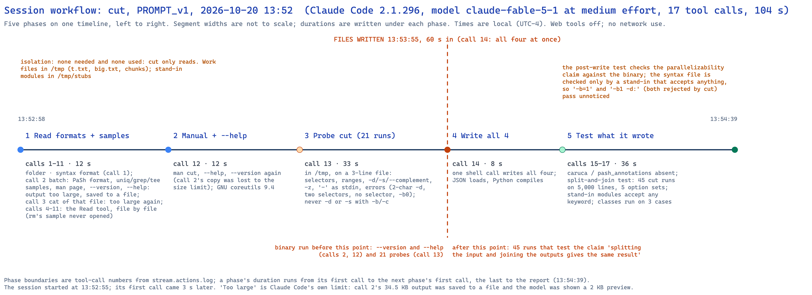
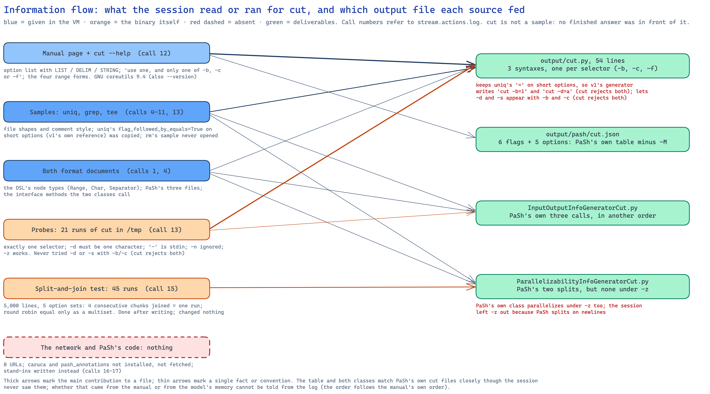
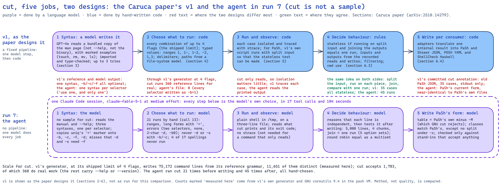

# Analysis of one run: `cut`, prompt version 1, 2026-10-20 13:52 (run 7)

**Run folder:** `naive_llm_caruca/runs/2026-10-20_135253_naive-run-cut_cut_PROMPT_v1/`
**Written:** 2026-10-20, from `stream.jsonl`, `stream.actions.log`, the session transcript, `run.env`,
`environment.txt` and the four output files. Call numbers below are the tool-call numbers printed in
`stream.actions.log` (1 to 17); times are local (UTC−4). The setup is the same as runs 4 (`grep`) and 5
(`rm`): same prompt, model and effort, and the same golden image except that it had gained the `binwalk`
package for run 6, which `cut` does not touch. **`cut` is not one of the four samples**, so, as in run 6
(`binwalk`), the session had no finished answer to start from; it is the first such run on a core
utility that v1 also covers. Runs 6 and 8 (`binwalk`, `convert`) were made and analysed in another
session. The checks marked "measured here" were run during this analysis, not by the session: v1's
real syntax module on the Mac, and GNU coreutils 9.4 in the `pash` virtual machine.

## Summary

A fresh Claude Code session (version 2.1.296, model `claude-fable-5-1` at medium effort, permissions
bypassed, web tools and MCP servers removed) in a throwaway Ubuntu 24.04 virtual machine was given
prompt version 1 for `cut`. In 104 seconds, 18 turns and 17 tool calls (9 shell, 8 file reads) it
produced all four files at a list-price cost of $1.25, with no network use. It read the formats and
three samples (`uniq`, `grep`, `tee`; never `rm`), the manual page and `--help`, ran `cut` 21 times on a
small file in `/tmp`, and wrote all four files in one call. Then, unlike run 5, it tested what it wrote.
It split a 5,000-line file into chunks, ran `cut` on each, joined the results and compared them with
one run over the whole file (45 runs). It also loaded its files against stand-in modules it wrote
itself. The parser table it wrote is PaSh's own `cut` table minus one flag (`-M`) that GNU `cut` does not
accept, and both classes match PaSh's own almost exactly, although the session never saw PaSh's `cut`
files. Loaded into PaSh's real code, they give PaSh's own answers except under `-z`. Its syntax file encodes one rule that v1's reference file for `cut` lacks ("use one, and only one
of `-b`, `-c` or `-f`"). It misses two others (`-d` and `-s` work only with `-f`). It also copies a
convention from the `uniq` sample that makes v1's generator write invocations such as `cut -b=1`, which
`cut` rejects.

## What this run teaches

In plain terms, the most useful things run 7 shows. One run, so these are observations to test, not
conclusions.

- **With no example to lean on, it still landed on PaSh's answer.** Its parser table and both classes
  are almost identical to the ones PaSh's authors wrote by hand for `cut`, files it never saw. The
  closeness could come from the manual, which lists the options in the same order, or from the model
  having seen PaSh's public files in training. The log cannot tell which.
- **It found a rule the reference grammar misses.** The manual says "use one, and only one of -b, -c or
  -f", and the agent's probes confirmed it. So the agent wrote three alternative syntaxes, one per
  selector. v1's curated grammar for `cut`, and v1's own model output, leave all three optional. As a
  result many invocations that v1 generates from them are ones `cut` refuses to run (measured below).
- **But it missed two rules of the same kind, and copied a habit that backfires.** It never tried `-d`
  or `-s` together with `-b` or `-c`, and `cut` refuses both combinations. It also copied the `uniq`
  example's way of marking an option whose value follows `=`. On a short option like `-b`, v1's
  generator turns that into `cut -b=1`, which `cut` rejects. The `uniq` example is v1's own curated
  file, and v1's generator does the same to `uniq -f`. The effect is total: fed to v1's generator, the
  agent's file yields no command line that `cut` both accepts and runs for real (only ones carrying
  `--help` or `--version` get through). v1's own model output for `cut` fails the same way. v1's
  hand-curated file yields 360 such lines at the shipped setting.
- **This time it tested, and one test was exactly the right one.** To check that `cut` can be
  parallelised, it split the input, ran `cut` on each piece, joined the outputs and compared them with a
  single run. That is the same idea as v1's own test for its "stateless" class, arrived at
  unprompted. Its test of the syntax file, however, used stand-in modules that accept any input, so it
  could not have caught anything.
- **It misread its screen once.** An empty `--output-delimiter` made `cut` print an invisible NUL
  character, which the terminal showed as a gap. The agent reported it as "a space … a quirk of
  coreutils 9.4". It is not a quirk: GNU `cut` uses NUL when the delimiter is empty.
- **The tool's output limit cost it a turn.** Its second call asked for everything at once (a format
  document, nine sample files, the manual, `--help`). The output was too large, so Claude Code saved it
  to a file and showed only a 2 KB preview. The agent then fell back to reading files one at a time,
  and asked for the manual again.

**What it means.** Without a sample, the agent is still fast and mostly right. It goes to the manual
and the binary, picks up a structural rule a human-written grammar missed, and tests its parallelism
claim the way v1 does. Its weaknesses are the ones runs 4 and 5 showed. It probes only the cases it
thinks of. It checks its syntax only against stand-ins. And it imports conventions without checking how
they are consumed downstream. Whether a syntax file is "right" depends on who reads it: as a
description of `cut` the agent's file is better than v1's reference; as input to v1's generator it is
worse.

## 2.1 Timeline and phases

| # | Phase | Calls | Start | Duration | What it read or ran |
|---|---|---|---|---|---|
| 1 | Read formats and samples | 1–11 (11) | 13:52:58 | 12 s | listed the folder, read the syntax format (call 1); one batch for PaSh's format, `uniq`'s, `grep`'s and `tee`'s sample files, the manual, `--version` and `--help` (call 2), whose 34.5 KB output Claude Code saved to a file, showing a 2 KB preview; `cat` of that file (call 3), saved again; then the Read tool on PaSh's format and six sample files (calls 4–11) |
| 2 | Manual and help | 12 (1) | 13:53:10 | 12 s | `man cut`, `cut --help`, `cut --version` (GNU coreutils 9.4), again, since call 2's copy never reached the model |
| 3 | Probe | 13 (1) | 13:53:22 | 33 s | 21 runs of `cut` in `/tmp` on a three-line file (`a:b:c`, `d:e:f`, `nodelim`), plus `tee`'s sample files |
| 4 | Write | 14 (1) | 13:53:55 | 8 s | one shell call wrote all four files, loaded the JSON and compiled the Python |
| 5 | Test what it wrote | 15–17 (3) | 13:54:03 | 36 s | looked for `caruca` and `pash_annotations` (absent); split-and-join test, 45 runs (call 15); wrote stand-in modules and loaded its files against them (call 16 failed on a wrong module path, call 17 repeated it correctly); report at 13:54:39 |

**First write:** call 14 at 13:53:55, 60 seconds into the session, after `--version`, `--help` and the 21
probes. After it: 45 runs of the binary (call 15), all testing the parallelizability claim. Nothing
after the write re-ran `cut` against the syntax file.

**Where the time went.** API time was 103.6 of the 103.9 seconds; the tool calls themselves returned
almost instantly.

## 2.2 Sources it used

**Inside the folder.**
- Both format documents (calls 1 and 4).
- Samples: `uniq` (syntax file, table, both classes), `grep` (syntax file, both classes; its table only
  inside call 2's lost output), `tee` (syntax file and table, appended to call 13). The `rm` sample was
  never opened.

**The manual page it was pointed to.** Rendered in full in call 12. It supplied the option list with the
manual's argument names (`LIST`, `DELIM`, `STRING`, all three used in the table) and the sentence "Use
one, and only one of -b, -c or -f", which became the three-syntax structure.

**The binary.** `--version` and `--help` (call 12), 21 probes (call 13), 45 split-and-join runs (call 15).

**Outside the folder.** Nothing: `bash_urls=0`. It checked whether `caruca` and `pash_annotations` could
be imported (call 15) and, when they could not, wrote stand-ins instead of fetching them.

**Copied versus derived.** `cut` is not a sample, so nothing could be copied directly. What came from
the samples is form: the comment style of PaSh's classes (`# list_of_all_flags = …`, `# Which ones do
affect input/output?`, as in `uniq`'s), and `uniq.py`'s use of `flag_followed_by_equals=True` on options
whose short form takes a separate word (section 2.6).

**Compared with PaSh's own `cut` files** (from `pash_annotations` 0.2.4 in the `pash` VM; the session
never saw them):

| File | PaSh's own | The agent's |
|---|---|---|
| `cut.json` | 7 flag entries, 5 options | the same 6 flag entries and 5 options, in the same order, with the same argument names; **only `-M` is missing**, and GNU `cut` 9.4 rejects `-M` ("invalid option", measured here) |
| input/output class | standard output; standard input when there are no operands; operands are streaming inputs | the same three calls in a different order, with comments |
| parallelizability class | split into consecutive chunks or round robin, run `cut` on each, concatenate; always | the same two, **except under `-z`**, where it declines to split, reasoning that PaSh's splitters cut at newlines |

## 2.3 Isolation and safety

`cut` only reads, so isolation matters little here, and the session used none: its files (`t.txt`,
`big.txt`, chunk files) and stand-in modules went in `/tmp`, and it deleted its chunk files after each
round. Nothing outside `/tmp` and `output/` was written. `output/` still holds two `__pycache__` folders
from its compile check (run 5 removed its own).

## 2.4 Testing

**The 21 probes (call 13), and what they established:**
- `-d: -f2` prints field 2 and passes through a line with no delimiter; `-s` drops it.
- Long forms with `=` (`--delimiter=: --fields=1,3 --output-delimiter=X`), range forms (`-b1-2,4-`,
  `-c-2`), `--complement`, `-n` (accepted, no effect), `-z` (NUL-terminated records), `-` as standard
  input, no file (standard input), a separate value (`-d : -f 2`), and a grouped flag (`-sf2`) all work.
- Errors: a two-character delimiter, two selectors (`-b1 -c1`), a repeated selector (`-f1 -f2`), no
  selector, `-b0`, and a missing file (`cut` reports it, still prints the other file, exits 1).

**After writing (calls 15–17).**
- **Split-and-join (call 15).** A 5,000-line file, five option sets (`-d: -f2,3`; `-d: -f1 --complement`;
  `-b1-3,7-`; `-c2-4 --output-delimiter=Z`; `-d: -s -f3 --output-delimiter=;`). Four consecutive chunks
  joined in order matched one run exactly; four round-robin pieces matched only as a sorted multiset,
  which the session noted. This tests the parallelizability class's claim against the binary. It did
  not test `-z`, the case the class treats differently.
- **Stand-ins (calls 16–17).** Its stand-in `caruca.ir.syntax` accepts any keyword (`**kw`) and any node
  name, so loading `cut.py` against it shows only that the file runs as Python. Its stand-in PaSh
  interface records method names, so the classes were shown to call the expected methods on three
  invocations.

**The closing report's claims, checked against the log.**

| Claim | Supported? |
|---|---|
| "Ran the binary on every option in short, long, `=`, spaced and bundled forms" | **Partly.** 13 of the manual's 17 spellings were run; `--bytes`, `--characters`, `--only-delimited` and `--zero-terminated` never were. `=` was tried only on long options |
| "Everything matched the spec above" | **No.** The probes came before the spec and were not re-run against it. The spec allows `-d` and `-s` with `-b`/`-c`, which `cut` rejects ("an input delimiter may be specified only when operating on fields", measured here); no probe tried those combinations |
| "Verified the parallelizability claim on a 5000-line file with five option mixes … consecutive chunks … reproduced the sequential output exactly, and round-robin matched as a multiset" | Yes: call 15 |
| "stubbed their interfaces … imported all modules, and exercised both generator classes" | Yes, against stand-ins that accept anything. The file does import under v1's real module (measured here; section 2.6) |
| "exactly one of `-b/-c/-f` is allowed and only once" | Yes: probes for two selectors, a repeated one and none |
| "`--output-delimiter=` with an empty value produced a space in the output … a quirk of coreutils 9.4" | **No.** It produces a NUL byte (`od -c` shows `a \0 b`, measured here); the terminal rendered it as a gap |
| "PaSh's parser expects an option's value as the next word, so attached forms like `-d:` … are not split" | **Yes** (measured here with PaSh's real parser): `cut -d: -f2` parses with no options and the operands `-d:` and `-f2`; `cut --fields=2 a` leaves `--fields=2` among the operands. PaSh's own `cut.json` behaves the same |

## 2.5 Reproducibility and versions

- **Recorded during the run:** `cut --version` (GNU coreutils 9.4) and the manual's footer. The OS was
  not queried; `run.env` records Ubuntu 24.04.4 LTS, aarch64.
- **In the output:** only the input/output class names a version ("tested with GNU coreutils 9.4"), 1 of
  4 files (run 4: 3 of 4; run 5: 1 of 4).
- **Repeatability:** each probe ran once.

## 2.6 Deliverable quality, mechanically

- All four files parse (`ast.parse`, `json.load`).
- **`output/cut.py` imports under v1's real `caruca.ir.syntax`** (v1's virtual environment on the Mac): 3
  syntaxes, 9 option nodes each, one `Path` operand per syntax with `ZERO_OR_MORE` and
  `dash_as_stdin=True`. `Range`, `Char` and `Separator` all exist in v1's module.
- **Against the manual:** the table and the syntax file each contain all 17 spellings and nothing else.
- **Against v1's reference** (`syntax_specs/cut.py`, last changed 2025-10-25): v1's reference has one
  syntax with all three selectors optional, `Delimiter` for `-d`, no `=` markers, and a `-w` flag marked
  "Only FreeBSD", which GNU `cut` rejects. v1's own model output for `cut`
  (`outputs/llm-dsl-generation/cut.py`) also has one syntax with optional selectors, and marks every
  valued option with `=`, as the agent did.
- **Two defects in the agent's syntax file, as v1's generator reads it** (next section): the `=`
  markers on `-b`, `-c`, `-f` and `-d` produce `cut -b=1` and `cut -d=a`; and `-d` and `-s` sit in all
  three syntaxes although `cut` accepts them only with `-f`.
- **In PaSh's real code** (measured here, `pash_annotations` 0.2.4 in the `pash` VM, using a copy of
  the package with the agent's three files laid over PaSh's, so the installed package was not
  changed). On five invocations (`cut -d : -f 2 a.txt`, `cut -d: -f2`, `cut -c 1-3 a b`,
  `cut -z -f 1`, `cut --fields=2 a`) the agent's table and classes gave the same parse, the same
  input/output answer and the same split-and-concatenate options as PaSh's own files, except
  `cut -z -f 1`, where the agent's class offers no split and PaSh's offers two.
- Not done here: scoring the syntax file against a reference.

### How v1's generator reads the three syntax files (measured here)

v1 turns a syntax file into concrete command lines (`caruca generate`), and those are what it then runs
and traces, so a syntax file is also an input to v1's pipeline. Each file below was fed to v1's own
generator, without changing v1 (its `--path` option loads a syntax file from another folder). Every
distinct command line was then run once in the `pash` VM (GNU coreutils 9.4) on a three-line input.
"Accepted" means `cut` exited 0. Command lines whose printed form a shell could not re-read (a quote
character used as the delimiter), or that name v1's path placeholders (`relpath_1`), are left out. That
quoting problem belongs to this check, not to v1, which does not run its lines through a shell.

At v1's shipped limit of 4 flags per command line:

| Syntax file | Distinct command lines | Judged | Accepted by `cut` | Accepted **and doing real work** (no `--help`/`--version`) | Main reasons for rejection |
|---|---|---|---|---|---|
| v1's curated reference | 11,651 | 9,856 | 1,783 (18.1%) | **360** (3.7% of 9,856) | two selectors 6,450; FreeBSD's `-w` 992; `-d` without `-f` 280; `-s` without `-f` 210; no selector 141 |
| v1's model output | 15,042 | 15,042 | 1,104 (7.3%) | **0** | two selectors 6,500; delimiter longer than one character 6,485; `=` after a short option 660; `-s` without `-f` 210; no selector 83 |
| the agent's (run 7) | 13,222 | 12,555 | 2,160 (17.2%) | **0** | delimiter longer than one character 9,150; `=` after a short option 875; `-s` without `-f` 370 |

The same holds at lower limits. At 1 flag per line, the agent's file gives 30 accepted lines and v1's
model output 2, all with `--help` or `--version`; v1's reference gives 15 lines that do real work. At 2
flags: agent 0, v1's model output 0, v1's reference 85.

Why the agent's file yields nothing usable: every line it generates carries a selector, and the agent
marked each selector with `=`, so v1's generator writes `-b=1`, `-c=1-2`, `-f=1,3`, which `cut` reads as
the list "`=1`" and rejects. The `-d=a` lines fail for a second reason (the delimiter becomes `=a`). A
line survives only when `--help` or `--version` makes `cut` exit before it checks the list.

So the three-syntax structure removes every "two selectors" and "no selector" line, as intended. But
the `=` convention, copied from the `uniq` sample and also present in v1's own model output, turns every
remaining line into an error. The same convention in v1's curated `uniq.py` has the same effect there: `uniq -f=1` is
rejected ("invalid number of fields to skip", measured here). These rates describe a syntax file as
generator input; they are not a score of its accuracy as a description of `cut`.

## 2.7 Cost and effort

| Measure | Value |
|---|---|
| Model | `claude-fable-5-1`, medium effort (list-price cost basis, billed to the Max subscription) |
| Turns | 18 |
| Tool calls | 17: 9 Bash, 8 Read |
| Wall clock | 103.9 s (API time 103.6 s); 13:52:55 to 13:54:39 |
| Input tokens (uncached) | 290 |
| Cache writes | 35,237 tokens |
| Cache reads | 343,743 tokens |
| Output tokens | 9,117, of which 1,464 thinking |
| Reported cost | $1.25 at list price |
| Permission denials | 0 (permissions bypassed) |
| Web search / fetch tools | not available; 0 URLs in shell commands |

Not included: the launcher's $0.02 trial call that chose the model.

## 2.8 Behaviour worth recording

- **It turned to the Read tool.** After Claude Code's output limit swallowed its batch read twice
  (calls 2 and 3), it switched to reading files one by one. Runs 4 to 6 used only the shell.
- **It said what it was unsure about, and most of it was right to be.** Its report lists five doubts:
  the helper functions in `cut.py`, `Range` for a comma list, excluding `-z`, attached values in PaSh's
  parser, and the empty output delimiter. The last one it explained wrongly.
- **It chose the opposite default from run 5 on doubt.** Under `-z` it declined to parallelise ("safer"),
  where PaSh's own class does not; in run 5 it kept the sample's form despite contrary evidence.
- **No questions asked**, nothing written outside `/tmp` and `output/`.

## How the Caruca paper designs the experiment, and what the agent chose instead

| Job | v1, as the paper designs it | Run 7's agent |
|---|---|---|
| 1. Learn the argument syntax | A model (GPT-4o) reads a bundled copy of the man page, with worked examples for `touch`, `rm`, `mv` and `ls`, and writes the syntax; it is imported and type-checked, up to three tries (section 3). v1's model output for `cut` has one syntax with all selectors optional; v1's curated reference likewise, plus FreeBSD's `-w` | Reads the manual and `--help`, probes, and writes three syntaxes, one per selector, because the manual and the binary say exactly one is required |
| 2. Choose what to run | Code enumerates flag combinations up to a limit with typed values (section 4). For `cut` at the shipped limit of 4, v1's reference yields 75,172 command lines, 11,651 of them distinct (measured here) | 21 command lines chosen by hand, then 45 runs for the split test |
| 3. Run and observe | Each case runs isolated and traced; for PaSh, v1's own pipeline runs with split input (section 5) | Plain shell in `/tmp`; reads what `cut` prints |
| 4. Decide the behaviour | Rules over the traces: `stateless` when running on split input and joining the outputs equals one run (section 6.3) | Reasoned, then **checked with the same idea**: split into four chunks, run, join, compare with one run |
| 5. Write for consumers | Adapters to PaSh's old JSON and others (section 6.4). v1's committed `cut` annotation (`caruca/save/cut.json`, 2024-12-08) has 35 cases, all `stateless`, standard output only, for `-f`, `-d … -f`, `-c` and `-b` with five ranges each | PaSh's current Python form, matching PaSh's own `cut` files except `-M` and `-z` |

**`cut` is the kind of command v1's pipeline is built for.** It reads, writes to standard output, and
handles each line on its own, so the paper's split-input test applies directly. v1's committed
annotation calls every case it covers `stateless`. The agent reached the same verdict and checked it the
same way, unprompted, at a fraction of the scale. Where the two differ is the syntax. The agent's
grammar states the selector rule v1's lacks, but v1's generator would turn the agent's grammar into
command lines `cut` rejects, apart from `--help` and `--version` ones, so v1's pipeline would have
nothing to trace.

**Cost.** The paper reports CPU time per command (section 7.4) and not the cost of its model step. Run 7
took 104 seconds and $1.25 at list price.

## Run 7 compared with runs 4 and 5

Same model, effort, prompt, image and day; different command.

| Measure | Run 4 (`grep`, sample) | Run 5 (`rm`, sample) | Run 7 (`cut`, not a sample) |
|---|---|---|---|
| Wall clock · turns · tool calls | 322 s · 11 · 10 | 60 s · 6 · 5 | 104 s · 18 · 17 |
| Output tokens (thinking) · cost | 24,495 (6,663) · $2.54 | 4,623 (937) · $0.80 | 9,117 (1,464) · $1.25 |
| Binary runs before writing | 72 | 27 | 21 (+ `--help`, `--version`) |
| Test after writing | harness against stand-ins; 154 binary runs | none | split-and-join, 45 binary runs; stand-ins |
| Parser table versus PaSh's own | identical to the sample | identical to the sample | identical to PaSh's (unseen) minus `-M` |
| Version named in output files | 3 of 4 | 1 of 4 | 1 of 4 |
| Report overstates | "Everything passed" (one failure) | bare `--interactive` (manual, not tested) | "every option … everything matched"; the NUL "quirk" |

## What this run suggests we ask next

1. **Score syntax files two ways:** as a description of the binary (against the binary and the reference)
   and as input to v1's generator (share of generated lines the binary accepts). Run 7 is better on the
   first and worse on the second.
2. **Fix or flag the `=` convention.** The format document's line "the value is attached with `=`, as in
   `--interactive=always`" and the `uniq` sample both lead to `-b=1`. Whether v1's generator should
   attach `=` only to long spellings is a v1 question to record as a finding, not to fix in v1.
3. **Run `cut` with prompt version 2** to see whether "derive from execution" makes it probe
   combinations such as `-b1 -d:`.
4. **Give the agent PaSh's real package** (or let it install one, as run 3 did), so that its class tests
   run against PaSh's code rather than stand-ins it wrote itself. For `cut` that would have changed
   nothing; for `sort` (run 9) it would have exposed a defect the stand-ins hid.

## Diagram tooling

The three diagrams were drawn with the Excalidraw diagram skill
(`https://github.com/coleam00/excalidraw-diagram-skill`, at `.claude/skills/excalidraw-diagram/`). **The
skill's repository declares no licence**; it is listed as third-party, unlicensed material in
`LICENSE-TEMPLATES.md`, and is kept in the repository by Tiran's decision of 2026-10-13. Elements were
placed by hand in the `*.spec.json` files beside each diagram and expanded with
`naive_llm_caruca/excalidraw_fill.py`; each was rendered with `uv run python render_excalidraw.py
<file>`, inspected, and corrected.
